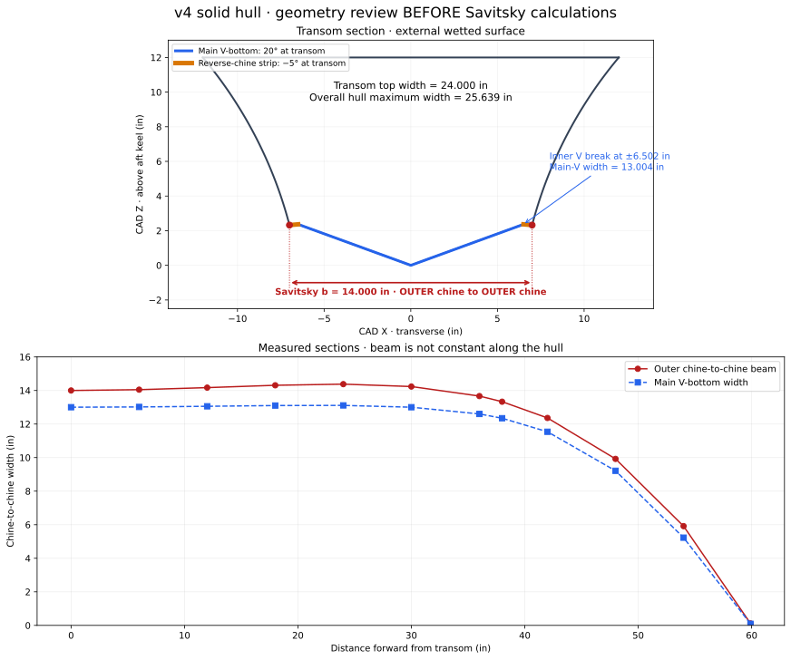

# v4 hull — dimensions for verification

**Geometry verified by the user. The first 0–30 mph speed sweep is complete.**

[Results and limitations](../../../outputs/savitsky/v4-2026-10-30/RESULTS.md) · [Performance curves](../../../outputs/savitsky/v4-2026-10-30/performance.svg) · [Input configuration](savitsky-inputs.json)

Source: [v4 - solid hull 10.30.26](<../../../cad/stepfiles/v4 - solid hull 10.30.26>). STEP export names this `v4 (Peyton sandbox) - Hull`. Open CASCADE reports valid geometry, one solid and 17 faces. The file contains external and internal shell surfaces; measurements below use the **external** transom and chine edges, not the internal shell.



## Dimensions

| Quantity | Measurement | Interpretation |
|---|---:|---|
| Overall length | 72.000 in / 1.8288 m | CAD Y, from transom to bow |
| Overall maximum width | 25.639 in / 0.651222 m | Envelope width; **not Savitsky b** |
| Transom top width | 24.000 in | Outer side to outer side at top of transom |
| Overall height | 12.000 in / 0.3048 m | CAD Z |
| **Outer transom chine beam, proposed b** | **14.000 in / 0.3556 m** | Between outer ends of the reverse-chine strips |
| Main V-bottom transom width | 13.003805 in / 0.330297 m | Between the inner edges of those strips |
| Main V transom angle | 20.000° | Straight main panel to horizontal at transom |
| Reverse-chine strip angle | −5.000° | Strip descends outward at transom |
| Reverse-chine strip length, each side | 0.500 in | Along the strip; horizontal width 0.498097 in |
| Outer chine height above aft keel | 2.322921 in | At transom |
| Inner V-break height above aft keel | 2.366499 in | At transom |
| Keel-to-outer-chine chord angle | 18.358212° | Geometric chord, **not** the main-panel deadrise |

The user verified the 14-inch outer chine beam; it is used as `b`. The 13.004-inch width identifies a second, inner break and is reported to avoid confusing the main V with the outer chine. The overall 25.639-inch envelope is not used as `b`.

The reverse-chine strip and main V have different slopes. The current constant-V engine cannot represent both explicitly. A main-panel-angle approximation and a keel-to-outer-chine chord approximation are different models of this section; neither is validated simply by measuring the CAD. **Both approximations have now been run: the 20° main-panel angle is the baseline; the 18.358212° chord is a comparison.** Neither run explicitly models the reverse-chine strip.

## Longitudinal variation

Exact curve evaluation at longitudinal stations shows the aft geometry is not strictly prismatic. Angles here are transverse straight chords, not local surface tangent angles.

| Forward of transom (in) | Outer chine beam (in) | Main V width (in) | Keel height (in) | Main V chord (°) | Outer-chine chord (°) |
|---:|---:|---:|---:|---:|---:|
| 0 | 14.000 | 13.004 | 0.000 | 20.000 | 18.358 |
| 12 | 14.171 | 13.058 | 0.023 | 20.010 | 17.845 |
| 24 | 14.379 | 13.111 | 0.142 | 19.919 | 16.716 |
| 36 | 13.667 | 12.602 | 0.510 | 19.639 | 15.558 |
| 38 | 13.332 | 12.347 | 0.617 | 19.604 | 15.395 |
| 48 | 9.923 | 9.214 | 1.529 | 20.130 | 14.613 |

Do not carry over the previous boat's assumed uniform 38-inch aft section without qualification. [sections.csv](sections.csv) contains all sampled values. This does not prevent an explicitly labeled equivalent-hull estimate, but the changing geometry must remain visible in interpretation.

## Supplied loading

[component-masses.csv](component-masses.csv) preserves the supplied loading. Coordinates: X transverse, Y forward from transom, Z above aft keel.

- Entered total: **125.107 lb / 56.74758063359 kg**.
- Mass-weighted CG: **X 0.003087 in; Y 23.734254 in; Z 6.023536 in**.
- Savitsky longitudinal CG: **0.602850060091 m** forward of transom.
- Savitsky vertical CG: **0.152997802756 m** above aft keel.

Blank mass rows are excluded, not filled with estimates. No assumption has been made that shell, glass, tubes or other blank rows are included in the 35.107-lb backbone entry.

## Agreed run setup

Reuse two propellers and the prior thrust line: angle 15°, point 0.122526739816 m aft of transom and 0.032824056184 m below the aft keel datum. Motor component CGs in the loading table are not thrust-line coordinates. Speed grid: 0–30 mph, 1-mph spacing. Low-speed coverage remains subject to the engine cutoff, not a prediction of planing onset.

[geometry-review.json](geometry-review.json) records source hashes, full-precision dimensions, sections, loading, thrust setup and pending assumptions. [measure_geometry.py](measure_geometry.py) reproduces the CAD measurements using `cadquery-ocp-novtk`; it runs no hydrodynamic calculation.

Re-run into a new output folder (existing folders are refused):

```sh
python3 hull/boats/v4-2026-10-30/run_savitsky.py --output outputs/savitsky/v4-new-run
```
