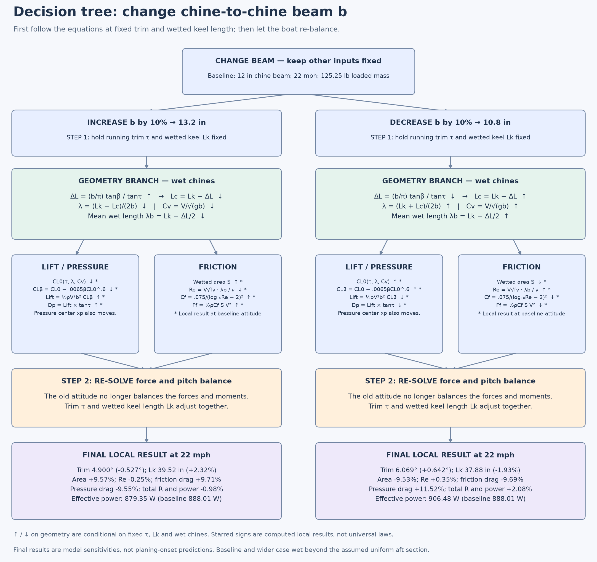

# Decision tree: what happens if I change a variable?

Start with a decision variable, choose **increase or decrease**, follow each equation branch, then re-solve trim and wetting. The detailed beam tree separates **changing an input at the old attitude** from **the new balanced running attitude**.



[Scalable beam tree](beam-decision-tree.svg) · [All decision variables: editable increase/decrease tree](decision-tree.mmd) · [Full numerical branch results](decision-sensitivities.md) · [Overall system map](variable-flow.md)

## Beam: follow every branch

First hold speed, trim τ, wetted keel length Lk, deadrise β and water properties fixed. On the wet-chine branch (`Lc > 0`), increasing beam b has the following geometry effects; decreasing b reverses these signs while remaining on this branch:

```text
Change chine beam b
├─ INCREASE b
│  ├─ ΔL = b tanβ / (π tanτ) increases
│  │  ├─ Lc = Lk − ΔL decreases
│  │  ├─ mean wet length λb = Lk − ΔL/2 decreases
│  │  └─ λ = Lk/b − tanβ/(2π tanτ) decreases
│  ├─ Cv = V / √(gb) decreases
│  ├─ spray angle α = atan2(b, 2ΔL) stays constant at fixed β, τ
│  ├─ wetted area S = b(Lk − ΔL/2)/cosβ increases on wet-chine branch
│  ├─ lift scale ½ρV²b² increases
│  │  └─ combine with changing CL0 and CLβ to get lift and pressure drag
│  └─ λb decreases AND bottom-flow factor fv changes
│     └─ Re = V √fv λb / ν → Cf → friction → friction moment
└─ DECREASE b
   └─ reverse the conditional geometry changes above;
      recompute lift and friction rather than assuming their net signs

Both choices
└─ changed forces + pressure center + friction height change pitch balance
   └─ solve vertical balance and pitch balance again
      └─ new τ AND Lk → recompute all branches → final R, T and PE
```

The area identity follows from `S1 + S2` in the notebook while chines are wet. Here `S1 = bΔL/(2cosβ)` and `S2 = b(Lk−ΔL)/cosβ`. Its derivative at fixed Lk, β, τ is `dS/db = (Lk−ΔL)/cosβ = Lc/cosβ > 0`. If the dry-chine clamp activates, use the notebook's clamped equations instead.

**Reynolds number does not necessarily increase with beam.** The complete chain is

\[
B=0.012\tau_{deg}^{1.1}\sqrt\lambda,\quad
f_v=1-\frac{B-0.0065\beta_{deg}B^{0.6}}{\lambda\cos\tau},\quad
Re=\frac{V\sqrt{f_v}\,\lambda b}{\nu}.
\]

Even though b appears in the numerator, λ is not independent of b. At the original attitude, a 10% beam increase changes Re from **8.283 million to 8.160 million**. After equilibrium is re-solved, Re is **8.262 million**. Since `Cf = 0.075/(log10(Re)−2)²`, lower Re raises Cf in this model's admissible range. Friction also depends on wetted area, so it has several input paths.

Lift also has competing paths:

\[
C_{L0}=\tau_{deg}^{1.1}\left(0.012\sqrt\lambda + 0.0055\lambda^{2.5}/C_v^2\right),\quad
C_{L\beta}=C_{L0}-0.0065\beta_{deg}C_{L0}^{0.6},\quad
L=\tfrac12\rho V^2b^2 C_{L\beta}.
\]

At the original attitude, the 10% wider beam lowers CLβ but raises lift from **527.3 N to 593.3 N**. That attitude no longer balances. Re-solving lowers trim from **5.427° to 4.900°**: pressure drag falls, friction rises, and total effective power falls **0.98%**. This is the final result for this case, not a universal wider-is-better rule.

## The other decision branches

In each branch below, direct effects hold τ and Lk fixed first. A signed moment becoming more positive or negative refers to the notebook's moment convention, not a promise about the resulting trim. Increasing and decreasing cases are both calculated in the [full numerical table](decision-sensitivities.md).

```text
Which decision are you changing?
├─ Loaded mass m ↑ / ↓
│  └─ W = mg ↑ / ↓
│     └─ Fz = L − Ff sinτ − W + T sin(τ+ε) decreases / increases
│        └─ re-solve τ and Lk → lift, wetting, both drags, R and PE
│
├─ Deadrise β ↑ / ↓
│  ├─ ΔL ∝ tanβ ↑ / ↓ → Lc and λ ↓ / ↑, while Cv stays fixed
│  ├─ lift correction −0.0065β CL0^0.6 changes directly
│  │  └─ CL0 also changes through λ → combine both for CLβ and lift
│  ├─ α, cosβ and wetted geometry change → S → friction
│  └─ pressure center xp + friction height zf change → re-solve τ, Lk
│
├─ CG forward coordinate xg ↑ / ↓ (move forward / aft)
│  ├─ Mp = −N(xg−xp) decreases / increases at fixed attitude
│  ├─ MT changes by −T sinε × change in xg
│  └─ no direct geometry change → changed pitch balance → re-solve
│
├─ CG height zg ↑ / ↓ (move up / down)
│  ├─ Mf = Ff(zf−zg) decreases / increases at fixed attitude
│  ├─ MT changes by +T cosε × change in zg
│  └─ competing moment contributions → re-solve τ, Lk
│
├─ Thrust-point height zT ↑ / ↓
│  └─ MT changes by −T cosε × change in zT → re-solve τ, Lk
│
├─ Thrust-point forward coordinate xT ↑ / ↓
│  └─ MT changes by +T sinε × change in xT → re-solve τ, Lk
│     (zero direct effect when ε = 0)
│
├─ Thrust angle ε ↑ / ↓
│  ├─ T = R/cos(τ+ε) changes even at fixed hull attitude
│  ├─ vertical thrust = R tan(τ+ε) changes → vertical balance
│  └─ MT = T[cosε(zg−zT)−sinε(xg−xT)] changes → pitch balance
│     └─ re-solve τ, Lk → required thrust, drag and power
│
└─ Overall length ↑ / ↓
   └─ validation, solver bounds/tolerance and wetting screen change
      └─ no explicit force-equation change with other inputs fixed
```

At fixed trim and λ, increasing β reduces the explicit deadrise lift correction; at fixed Lk, λ changes too. Likewise, a CG or shaft move does not directly change wetted geometry until the balance equations are solved. This distinction determines which arrows can be assigned guaranteed signs.

For mass changes, actual component moves, beam changes or shaft changes, update all physically coupled inputs together after exploring the isolated branches. For example, moving a battery changes CG; widening a real hull may also change mass. Moving the reference thrust point along the same physical shaft line leaves its moment unchanged.

## Reading the final leaves

The [all-variable decision tree](decision-tree.mmd) uses the committed defaults at **22 mph**. It branches each decision into increase and decrease, then reports the final trim, wetting, pressure drag, friction drag and power changes. These local results are calculated by the actual notebook functions, including the re-solve. Step sizes are explicit and are not a normalized ranking of variable importance.

The baseline wets beyond the assumed 38-inch uniform aft section; empirical screening and geometry flags remain in the numerical table. The model does not resolve planing onset, transition resistance or dynamic stability.

Regenerate the trees and table with:

```sh
python3 hull/diagrams/build_decision_tree.py
```

The generator reads function definitions from the notebook and uses its input JSON. It does not execute notebook cells or change equations, defaults or calculation outputs.
