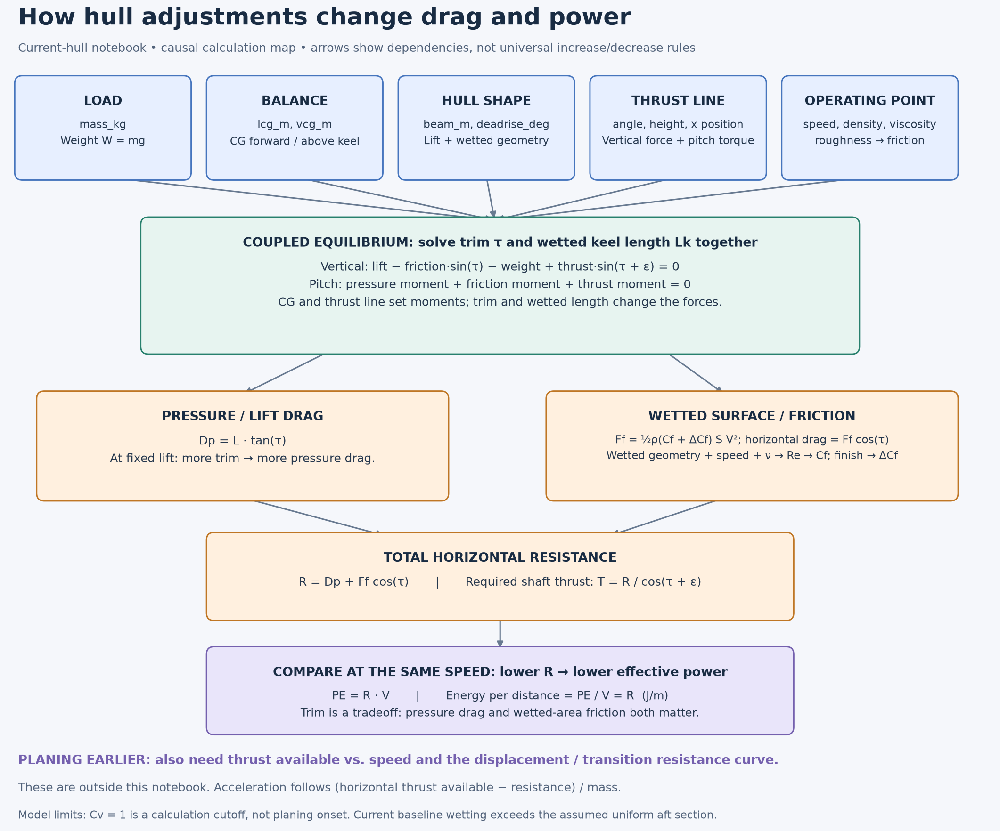

# How adjustments affect planing and efficiency

This map follows the equations in [current-hull.ipynb](../../optimization/savitsky/current-hull.ipynb), using its **1964, no-flap equivalent V-bottom model**. Arrows mean calculation dependencies, not statistical correlation. An adjustment must be solved again because trim and wetted length change together.

[Scalable diagram](variable-flow.svg) · [Editable Mermaid diagram with propulsion and acceleration links](variable-flow.mmd)

## What we are trying to improve

There are three related targets: **lower speed to sustain planing**, **less time to reach plane**, and **less battery energy per distance once running**. They need separate comparisons. This notebook calculates steady running attitude, required thrust, resistance and effective power; it does not calculate a planing-onset speed or acceleration history.

For the modeled running condition, compare resistance **at the same speed and payload**. Effective power is `PE = R × V`; effective energy per distance is `PE / V = R` in J/m. For an electrical comparison, extend this to `Pbattery ≈ PE / (ηpropulsive × ηdrive) + Paux`, with efficiencies appropriate to each operating point. Here `ηpropulsive = PE / Pshaft`; shaft power is `torque × angular speed = torque × 2π × RPM / 60`. These propulsion efficiencies are outside this notebook.

For time onto plane, the missing comparison is **available horizontal thrust minus resistance across the transition**, together with mass and a defined planing criterion. A simple straight-line acceleration extension is `dV/dt ≈ (Tavailable,horizontal − R) / m`. It requires a displacement/transition resistance model and propulsion data; substituting the notebook's unavailable low-speed results would not predict takeoff correctly. A lower sustained-planing speed also needs a suitable criterion and validation.

## How to read the main tradeoffs

| Adjustment | Path through this notebook | How to interpret it |
|---|---|---|
| Loaded mass | Weight → vertical balance → trim and wetting → both drag terms | Less weight changes the lift required. Do not assume every intermediate value falls. |
| CG forward/aft (`lcg_m`) | Pressure and thrust moment arms → running trim and wetting | More forward is a larger x coordinate. Moving forward lowered trim but increased wetted area in the example below. |
| CG height (`vcg_m`) | Friction and thrust moment arms → running attitude | This is a steady pitch calculation; it does not predict roll stability or porpoising. |
| Chine beam | Lift scale `ρV²b²/2`, speed coefficient, wetted geometry → equilibrium | More beam changes lift and friction together. An isolated beam edit holds mass fixed; a real wider hull can add mass. |
| Deadrise | Lift coefficient, chine/keel wetting difference, wetted area → equilibrium | At fixed trim and λ, more deadrise reduces the modeled lift coefficient. Net drag requires re-solving. |
| Thrust angle / shaft-line location | Vertical thrust support + pitch torque → trim and wetting | Changing angle changes both support and torque; changing location changes torque. Compare total energy after propeller/drive effects too. |
| Speed | Lift, pressure center, wetting, Reynolds number, friction, and `PE = RV` | Re-solve at each speed. Neither drag nor power has a single fixed speed exponent here. |
| Roughness / viscosity | Friction coefficient → friction and its moment → equilibrium | Roughness zero disables the allowance. A positive roughness case is a different branch; re-solve instead of assuming a smooth extrapolation from zero. |
| Water density | Lift and friction force scales → equilibrium | A water-property input, rather than an independent hull adjustment. |
| Overall length | Input validation, wetting-length screen, solver bracketing/tolerance | No explicit length benefit in the force equations at fixed beam, mass, CG and other inputs. Do not use this as a prediction that real hull length has no effect. |
| Uniform aft length | Forebody-approximation warning | Changing this number alone changes the warning, not forces. |
| Propeller count | Total required thrust divided equally for reporting | Increasing the count alone does not change total thrust or power in this notebook. Real propeller sizing/interaction is outside its scope. |

**The trim tradeoff:** pressure drag is `L tan(τ)`, so more trim at fixed lift increases pressure drag. Wetted area drives friction, so less area at fixed speed and friction coefficient reduces friction. The solver balances the boat between these effects. Lowest trim and shortest wetted length are not standalone efficiency objectives.

A shaft-line detail: `thrust_x_m` and `thrust_height_m` describe a point on a line. Moving that point along the *same* line does not change its torque. A physical adjustment must actually change the line's angle or offset to affect the result.

## Actual adjustment examples at 22 mph

Calculated from the committed input JSON and notebook functions on 2026-10-30. Each row changes **one input**, holds all others and speed fixed, and re-solves equilibrium. These are local model sensitivities, not universal trends or measured performance. The different adjustment sizes also mean this is not a normalized ranking of variable importance.

| Adjustment | Trim (°) | Wetted keel (in) | Wetted area (m²) | Effective power (W) | Power change | Geometry flag |
|---|---:|---:|---:|---:|---:|---|
| Baseline | 5.427 | 38.63 | 0.2697 | 888.01 | +0.00% | Beyond uniform aft |
| Mass −10% | 4.971 | 39.13 | 0.2703 | 802.70 | -9.61% | Beyond uniform aft |
| CG forward 1 in | 5.260 | 40.48 | 0.2833 | 889.31 | +0.15% | Beyond uniform aft |
| CG aft 1 in | 5.600 | 36.81 | 0.2564 | 887.38 | -0.07% | Within uniform aft |
| Beam +10% | 4.900 | 39.52 | 0.2955 | 879.35 | -0.98% | Beyond uniform aft |
| Deadrise −2° | 5.279 | 38.01 | 0.2678 | 872.31 | -1.77% | Beyond uniform aft |
| Thrust angle 15° → 10° | 5.574 | 37.76 | 0.2639 | 902.06 | +1.58% | Within uniform aft |
| CG down 1 in | 5.411 | 38.80 | 0.2710 | 888.11 | +0.01% | Beyond uniform aft |
| Thrust line up 1 in | 5.399 | 38.94 | 0.2720 | 888.19 | +0.02% | Beyond uniform aft |
| Overall length +10% | 5.427 | 38.63 | 0.2697 | 888.01 | +0.00% | Beyond uniform aft |

All listed cases pass the notebook's empirical screen; the separate geometry column checks the assumed 38-inch uniform aft section. The baseline and most variants wet beyond it, so the equivalent prismatic approximation remains unresolved. Tiny power differences should not decide a build.

The useful example is **mass −10%**: predicted power falls **9.61%**, yet wetted length rises slightly because equilibrium trim changes. Likewise, moving CG forward reduces trim but slightly increases power here. This is why a simple chain saying “less trim → less drag” would be misleading.

For design iterations, sweep speed and compare trim, wetting, resistance, required thrust and warnings together, as sections 7–9 already support. Recompute mass and CG together for real equipment moves or geometry changes. To evaluate earlier planing, add the missing transition resistance and available-thrust curves, then validate against a speed/trim/throttle test. `Cv = 1` is only the notebook's evaluation cutoff, **not** a planing-onset result.

## Equation trace

- Notebook section 3, `geometry_and_lift`: wetting, lift, pressure center and pressure drag.
- Section 4, `forces`: friction, resistance, required shaft thrust, effective power and signed force/moment balances.
- Section 5, `vertical_balance` and `solve`: coupled trim/wetted-length solution and empirical checks.
- `run_sweep`: uniform-aft warning and equal per-prop reporting.
- Section 9: existing interface for recomputing input scenarios.

This is an explanatory addition. Notebook equations, defaults, executable cells and saved calculation outputs are unchanged.
