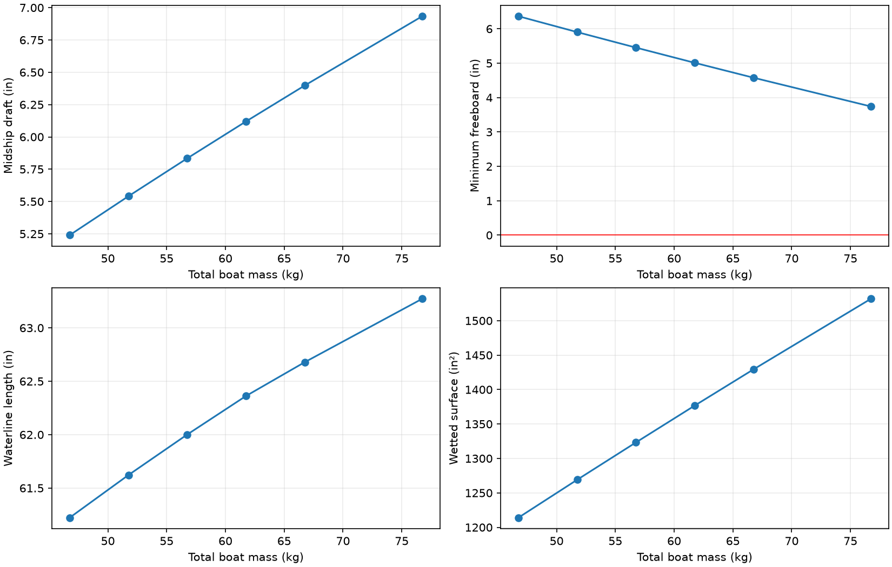

# v4 NavalToolbox hydrostatics

Mass: 56.748 kg. Minimum freeboard: 5.45 in. Midship draft: 5.83 in. Waterline length: 62.00 in.

[Full results](hydrostatics.csv) · [Inputs and box verification](study.json)

Static dry-interior flotation only. Fixed whole-boat CG during mass sweep. Positive trim is bow down. No speed/thrust/planing. Rim immersion invalidates the dry-interior assumption.
