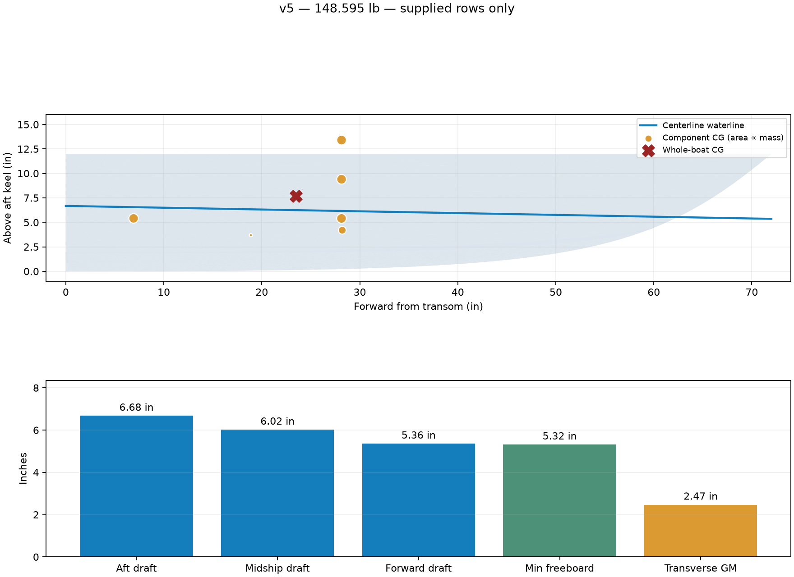

# v5 NavalToolbox hydrostatics

**Supplied-row loading — blank component weights intentionally excluded as requested.**

- Total mass: 148.595 lb
- Aft draft: 6.679 in
- Midship draft: 6.020 in
- Forward draft: 5.360 in
- Trim (positive bow down): -1.049 deg
- Heel: -0.009 deg
- Minimum rim freeboard: 5.318 in
- Waterline length: 62.456 in
- Wetted area: 1458.386 in²
- Initial transverse GM: 2.471 in

Whole-boat CAD CG (X/Y/Z): -0.00104, 23.48884, 7.66302 in.

## Assumptions and loading scope

- Freshwater density 998.2 kg/m³, retained from v4.
- CAD X transverse; CAD Y forward from transom; CAD Z above aft keel, as in v4. Physical transverse sign unconfirmed.
- Dry interior below the 12-inch rim; no added tube/appendage buoyancy. Rim immersion invalidates this envelope.
- Every filled CSV row is included independently, including all three repeated battery IDs.
- Blank component rows are intentionally excluded from this supplied-row loading, as requested.
- Static equilibrium and initial GM only; no speed, planing, waves or large-angle stability calculation.

Intentionally excluded blank rows: Fiberglass resin fairing and paint, Port tube, Starboard tube, Backbone and frame, Baseboard, Port motor controller, Starboard motor controller, Electronics enclosure, Electronics and power distribution, Sensor tower and sensors, Wiring connectors and cables, Fasteners mounts and adhesives, Front payload.

## Numerical checks

Mesh/STEP volume difference: 0.00944%. Mass-balance error: 0.00124%. Maximum analytical-box error: 0.00610%. These checks establish numerical consistency, not physical validation.

[CSV results](hydrostatics.csv) · [Full inputs, assumptions and checks](study.json) · [Original loading snapshot](component-masses-input.csv)
