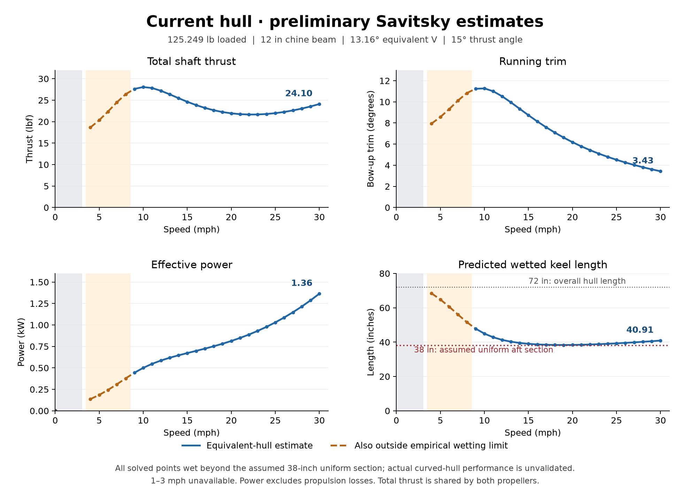

# Preliminary current-hull Savitsky sweep

Every integer mph from 0–30. These are estimates for an equivalent V-bottom, not validated actual-hull performance.

## Performance charts

Total thrust peaks near **28.1 lbf at 10 mph**, falls to about **21.7 lbf at 22 mph**, then rises to **24.1 lbf at 30 mph** in this model. Effective power continues to rise, reaching **1.36 kW at 30 mph**; this excludes motor and propeller losses. Divide total thrust by two for the equal-thrust estimate per propeller.

The dashed orange segments at 4–8 mph exceed the empirical wetted-length/beam limit. The gray low-speed region has no displacement-resistance prediction. **Every solved point extends beyond the assumed 38-inch uniform aft section**, so even the blue curves remain approximations for the actual hull. The chart does not establish planing onset or dynamic stability.

[Download vector charts](performance-charts.svg). Rebuild with `python3 plot_results.py` from this folder; the charts use the unrounded values in `results.json`.

## Results at every mph

| mph | Trim ° | Total thrust lbf | Each prop lbf | Effective kW | Wet keel in | Status |
|---:|---:|---:|---:|---:|---:|---|
| 0 | — | — | — | 0.000 | — | Static |
| 1 | — | — | — | — | — | Unavailable |
| 2 | — | — | — | — | — | Unavailable |
| 3 | — | — | — | — | — | Unavailable |
| 4 | 7.95 | 18.65 | 9.33 | 0.137 | 68.4 | Empirical limits + forebody |
| 5 | 8.56 | 20.35 | 10.18 | 0.185 | 64.8 | Empirical limits + forebody |
| 6 | 9.31 | 22.36 | 11.18 | 0.243 | 60.6 | Empirical limits + forebody |
| 7 | 10.12 | 24.50 | 12.25 | 0.309 | 56.0 | Empirical limits + forebody |
| 8 | 10.83 | 26.39 | 13.20 | 0.378 | 51.6 | Empirical limits + forebody |
| 9 | 11.24 | 27.63 | 13.82 | 0.444 | 47.9 | Forebody approximation |
| 10 | 11.27 | 28.06 | 14.03 | 0.500 | 45.0 | Forebody approximation |
| 11 | 11.00 | 27.83 | 13.92 | 0.547 | 42.8 | Forebody approximation |
| 12 | 10.53 | 27.20 | 13.60 | 0.586 | 41.3 | Forebody approximation |
| 13 | 9.96 | 26.37 | 13.18 | 0.618 | 40.3 | Forebody approximation |
| 14 | 9.34 | 25.48 | 12.74 | 0.646 | 39.5 | Forebody approximation |
| 15 | 8.74 | 24.63 | 12.32 | 0.673 | 39.0 | Forebody approximation |
| 16 | 8.15 | 23.86 | 11.93 | 0.698 | 38.7 | Forebody approximation |
| 17 | 7.60 | 23.20 | 11.60 | 0.724 | 38.5 | Forebody approximation |
| 18 | 7.09 | 22.66 | 11.33 | 0.752 | 38.4 | Forebody approximation |
| 19 | 6.62 | 22.24 | 11.12 | 0.781 | 38.3 | Forebody approximation |
| 20 | 6.18 | 21.94 | 10.97 | 0.813 | 38.4 | Forebody approximation |
| 21 | 5.79 | 21.75 | 10.87 | 0.849 | 38.5 | Forebody approximation |
| 22 | 5.43 | 21.66 | 10.83 | 0.888 | 38.6 | Forebody approximation |
| 23 | 5.10 | 21.68 | 10.84 | 0.931 | 38.8 | Forebody approximation |
| 24 | 4.79 | 21.78 | 10.89 | 0.978 | 39.0 | Forebody approximation |
| 25 | 4.52 | 21.98 | 10.99 | 1.030 | 39.3 | Forebody approximation |
| 26 | 4.26 | 22.26 | 11.13 | 1.086 | 39.6 | Forebody approximation |
| 27 | 4.03 | 22.62 | 11.31 | 1.148 | 39.9 | Forebody approximation |
| 28 | 3.81 | 23.04 | 11.52 | 1.215 | 40.2 | Forebody approximation |
| 29 | 3.61 | 23.54 | 11.77 | 1.287 | 40.5 | Forebody approximation |
| 30 | 3.43 | 24.10 | 12.05 | 1.364 | 40.9 | Forebody approximation |

## Inputs and assumptions

Loaded weight 125.249 lb; length 72 in; chine beam 12 in; LCG 23.547 in; VCG 6.079 in. Twin prop centers X ±4, Y −4.823887, Z −1.292286 in. Thrust angle +15 degrees.

- Equivalent constant V-bottom: atan(1.403/6) = 13.161 degrees; curved section with 5-degree keel slope is not represented exactly.
- Aft 38 inches assumed uniform; all solved points predict wetting beyond this section. No clipping of predicted wetting.
- Freshwater 20 C, density 998.2 kg/m3, viscosity 1.004e-6 m2/s.
- Smooth hull: roughness allowance zero. Fully turbulent ITTC friction; actual finish unknown.
- No displacement/wave-making resistance, appendage drag, air drag, propeller interaction, waves or dynamic stability model.
- Total thrust is along both shafts combined. Per-prop figures assume equal thrust. Effective power is horizontal resistance times speed, not motor shaft or battery power.
- CAD +Y forward, +Z up; aft keel assumed parallel to top plane; transverse CG offset 0.004 in ignored in symmetric calculation.
- Cv<1 cutoff is not a prediction of planing onset.

At 4–8 mph, mean wetted length/beam also exceeds 4. At 0 mph steady-motion resistance and effective power are zero; static draft/trim and propeller operating point are not calculated. 1–3 mph require a displacement model. 9–30 mph pass the engine checks but remain forebody/curved-section approximations. No planing-onset or attainable-top-speed claim is made.

## Verification

Eight existing regression tests passed, including reproduction of the upstream published worked example. Maximum normalized current-sweep equilibrium residual: 2.749e-15. Translating the thrust application point along its shaft line leaves equilibrium unchanged. Numerical checks do not establish experimental accuracy or dynamic stability.

Sources: [Savitsky 1964](https://onepetro.org/MTSN/article-abstract/1/04/71/172383/Hydrodynamic-Design-of-Planing-Hulls), [OpenPlaning](https://github.com/elcf/python-openplaning). Complete inputs and unrounded output: [results.json](results.json).
